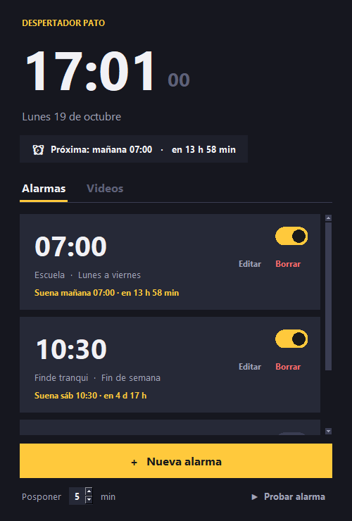

# 🦆 Despertador Pato

Reloj despertador para PC que, cuando suena, abre en tu navegador un video **al azar** de YouTube sacado de tu lista.

Tiene **interfaz gráfica** y también **versión de terminal**. Solo usa la biblioteca estándar de Python (3.8+), así que no hace falta instalar nada.

<p>
  
  
</p>

## Interfaz gráfica

Hacé **doble clic en `Despertador.pyw`**, o ejecutá:

```bash
py despertador_gui.py
```

Qué podés hacer:

- **Varias alarmas**, cada una con su nombre y sus días (lunes a viernes, fin de semana, días sueltos o una sola vez).
- **Activar o desactivar** cada alarma con su interruptor, sin borrarla.
- **Posponer**: cuando suena, el botón "Posponer" la vuelve a hacer sonar en N minutos. Los minutos se configuran abajo de la lista.
- **Editar la lista de videos** desde la pestaña *Videos*: pegás un link, tocás *Agregar*, y listo.
- **Sin repetir**: los últimos videos que sonaron no se eligen de nuevo enseguida.
- **Próxima alarma** siempre visible arriba ("mañana 07:00 · en 8 h 12 min").
- **Probar alarma**, para ver cómo suena sin esperar.
- Si no hay videos, no hay internet o no se puede abrir el navegador, suena un **beep de respaldo** hasta que la apagues.

Las alarmas se guardan en `alarmas.json`, en la misma carpeta, así que siguen ahí la próxima vez que abras el programa.

> **Importante:** el programa tiene que estar abierto para que suenen las alarmas. Si lo cerrás, te pregunta si preferís minimizarlo.

## Versión de terminal

```bash
py despertador.py 07:30        # suena a las 07:30 (si esa hora ya pasó, suena mañana)
py despertador.py --en 10      # suena dentro de 10 minutos
py despertador.py --en 0.1     # suena en ~6 segundos (para probar)
py despertador.py 07:30 --posponer 10 --archivo otra_lista.txt
```

Cuando suena: apretá **Enter** para apagarla, o **p + Enter** para posponerla.

> En Windows usá `py`. En Linux/macOS usá `python3`.

## La lista de videos (`urls.txt`)

Va una URL por línea. Las líneas vacías y las que empiezan con `#` se ignoran. Se aceptan links de `youtube.com`, `youtu.be`, `m.youtube.com` y `music.youtube.com`.

Podés editar la lista desde la interfaz o a mano. Ojo: al agregar o quitar videos desde la interfaz, el archivo se reescribe y se pierden los comentarios que le hayas puesto.

## Estructura

| Archivo | Qué hace |
|---|---|
| `Despertador.pyw` | Abre la interfaz gráfica sin ventana de terminal |
| `despertador_gui.py` | Interfaz gráfica (Tkinter) |
| `despertador.py` | Versión de terminal |
| `nucleo.py` | Lógica compartida: alarmas, videos, configuración |
| `tests/` | Tests automáticos (`py -m unittest discover -s tests`) |

## Limitaciones conocidas

- La PC tiene que estar prendida y el programa abierto. Si la PC estaba suspendida a la hora de la alarma, suena al despertarse, siempre que no haya pasado más de una hora.
- Algunos navegadores bloquean la reproducción automática con sonido. Si el video abre pausado, permití el autoplay para youtube.com en la configuración del navegador.
