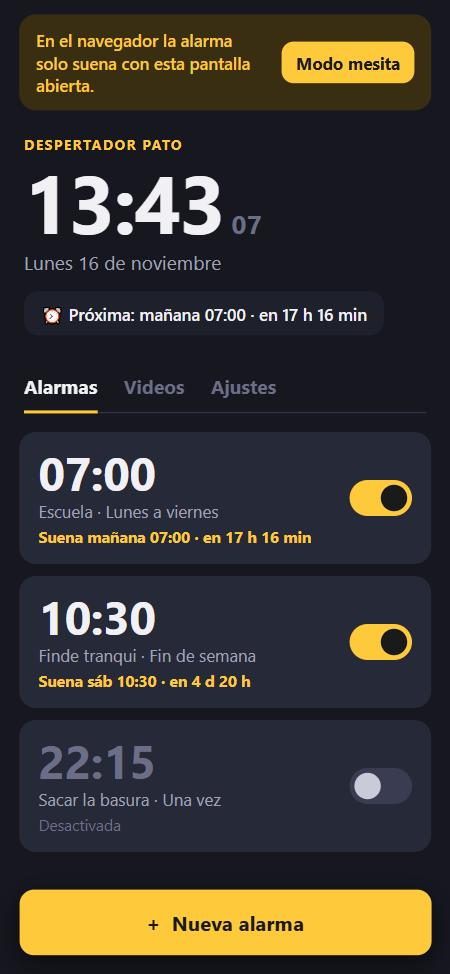

# Despertador Pato para celulares

<p>
  
</p>

La versión móvil es **una sola app web** (HTML, CSS y JavaScript, sin frameworks) que se usa de dos formas:

| | Android (app instalable) | iPhone o cualquier navegador (app web) |
|---|---|---|
| Cómo se instala | Descargando el APK desde [Releases](https://github.com/axelito-coder/despertador-pato/releases/tag/android-latest) | Abriendo la página y eligiendo "Agregar a pantalla de inicio" |
| ¿Suena con el celular bloqueado? | **Sí**, aunque la app esté cerrada | **No**: la app tiene que quedar abierta (modo mesita de luz) |
| Qué te despierta | **El video**: a la hora, la app se abre sola encima de la pantalla de bloqueo y lo reproduce con sonido, como el despertador de Android | **El video**: se reproduce solo, a pantalla completa, con sonido |
| Si el video no puede arrancar | Suena un pitido y la pantalla "¡ARRIBA!" explica por qué | Igual, o el video arranca sin sonido con el pitido de respaldo hasta que toques **Tocá para escuchar el video** |

## Instalar en Android

1. Desde el celular, entrá a [Releases → android-latest](https://github.com/axelito-coder/despertador-pato/releases/tag/android-latest) y descargá `despertador-pato.apk`.
2. Abrí el archivo. Android va a pedir permiso para instalar apps desde el navegador: aceptalo.
3. Al abrir la app por primera vez, permití las notificaciones. Sin ese permiso las alarmas no suenan.
4. En **Ajustes → Permisos de Android** revisá que las tres opciones digan "Permitidas ✓". La más importante para el video es **Alarma de pantalla completa**: desde Android 14 se puede desactivar, y sin ella la app no se abre sola con el celular bloqueado.
5. En **Ajustes → Probar alarma**, bloqueá el celular y esperá 10 segundos: tiene que prenderse la pantalla y arrancar el video.

Para actualizar, descargá el APK nuevo y abrilo: se instala encima del anterior y conserva tus alarmas.

Consejos para que no falle:

- Desactivá la optimización de batería para la app (Ajustes de Android → Apps → Despertador Pato → Batería → Sin restricciones). Algunas marcas, como Xiaomi, Huawei o Samsung, cierran las apps en segundo plano de forma agresiva.
- La alarma suena con el volumen de alarma de Android: revisá que no esté al mínimo.

## Usar en iPhone (o en cualquier navegador)

1. Abrí la app web en Safari (la dirección aparece cuando se active GitHub Pages; ver abajo).
2. Tocá *Compartir → Agregar a pantalla de inicio*.
3. Antes de dormir, abrila, tocá **Modo mesita** y dejá el celular cargando con la app abierta.

Apple no deja que una app web suene con el celular bloqueado: esa es la diferencia con la versión Android.

**Sonido del video en iPhone:** Safari no deja arrancar un video con sonido por su cuenta. Por eso, en iPhone el video arranca sin sonido, suena un pitido para despertarte, y con un toque en **Tocá para escuchar el video** pasa a sonar el video. Además, sacá el iPhone del modo silencio: en ese modo iOS silencia el sonido de las páginas web.

## Cómo funciona

- [`www/alarmas.js`](www/alarmas.js): la lógica pura (próxima alarma, agenda, videos), equivalente a `nucleo.py` de la versión de PC. No toca la pantalla, así se puede testear con Node.
- Cuando suena, el video se reproduce en pantalla completa con la [API de YouTube](https://developers.google.com/youtube/iframe_api_reference). Si termina y nadie apagó la alarma, sigue con otro video al azar. Si YouTube no deja reproducir un video (algunos no se pueden ver fuera de YouTube), prueba con otro. Después de 4 fallas, o sin internet, suena el pitido de respaldo.
- [`www/app.js`](www/app.js): la interfaz y los dos modos. Si corre dentro de la app Android (`Capacitor.isNativePlatform()`), programa las alarmas como notificaciones del sistema. Si no, revisa la hora cada segundo y suena con Web Audio.
- En Android, el aviso principal de cada alarma es una **alarma de pantalla completa** propia ([`AlarmaPlugin.java`](android/app/src/main/java/io/github/axelitocoder/despertadorpato/AlarmaPlugin.java) y [`AlarmaReceiver.java`](android/app/src/main/java/io/github/axelitocoder/despertadorpato/AlarmaReceiver.java)). Se programa con `AlarmManager.setAlarmClock`, igual que el reloj de Android, y al sonar publica una notificación con *full screen intent*. Con el celular bloqueado, eso abre la app encima del bloqueo y arranca el video. Si el celular se está usando, aparece como notificación emergente con sonido.
- Además de ese aviso principal, hay **2 avisos de respaldo** (+1 y +2 minutos) con el plugin de notificaciones de Capacitor, por si la app no se pudo abrir. Se cancelan solos cuando arranca el video. Todo se programa con 14 días de anticipación. Cada vez que abrís la app se vuelve a armar la agenda. Si no la abrís en 14 días, las alarmas dejan de sonar.
- Los datos se guardan en el almacenamiento local del celular (`localStorage`).
- [`android/`](android/): proyecto Android generado por [Capacitor](https://capacitorjs.com/) 7, con los permisos de alarmas exactas, el sonido y los íconos.

## Desarrollo

Necesitás Node 22 o superior. Desde esta carpeta:

```bash
npm install
npm test                          # tests de la lógica
py herramientas/servir.py         # app web en http://localhost:8080
```

Para generar el APK no hace falta Android Studio. Cada push a `main` que toque `movil/` lo compila GitHub Actions ([`android.yml`](../.github/workflows/android.yml)) y lo publica en Releases. Para compilarlo en tu PC necesitás Android Studio y Java 21:

```bash
npx cap sync android
cd android && ./gradlew assembleDebug
```

Si cambiás los íconos o el sonido, editá y ejecutá `py herramientas/generar_recursos.py`.

### Publicar la app web

El workflow [`pages.yml`](../.github/workflows/pages.yml) publica `www/` en GitHub Pages. Hay que activarlo una sola vez: en GitHub, **Settings → Pages → Build and deployment → Source: GitHub Actions**. Después queda en `https://axelito-coder.github.io/despertador-pato/`.
