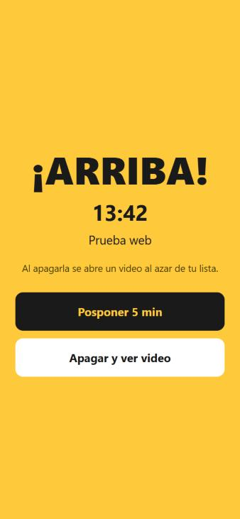

# Despertador Pato para celulares

<p>
  
  
</p>

La versión móvil es **una sola app web** (HTML, CSS y JavaScript, sin frameworks) que se usa de dos formas:

| | Android (app instalable) | iPhone o cualquier navegador (app web) |
|---|---|---|
| Cómo se instala | Descargando el APK desde [Releases](https://github.com/axelito-coder/despertador-pato/releases/tag/android-latest) | Abriendo la página y eligiendo "Agregar a pantalla de inicio" |
| ¿Suena con el celular bloqueado? | **Sí**, aunque la app esté cerrada | **No**: la app tiene que quedar abierta (modo mesita de luz) |
| Sonido | `alarma.wav`, con el volumen de **alarma** (suena aunque el celular esté en silencio) | Pitidos generados con Web Audio |
| Al apagarla | Abre un video al azar en la app de YouTube | Abre un video al azar en una pestaña nueva |

## Instalar en Android

1. Desde el celular, entrá a [Releases → android-latest](https://github.com/axelito-coder/despertador-pato/releases/tag/android-latest) y descargá `despertador-pato.apk`.
2. Abrí el archivo. Android va a pedir permiso para instalar apps desde el navegador: aceptalo.
3. Al abrir la app por primera vez, permití las notificaciones. Sin ese permiso las alarmas no suenan.
4. En **Ajustes → Probar alarma**, bloqueá el celular y esperá 10 segundos para comprobar que suena.

Para actualizar, descargá el APK nuevo y abrilo: se instala encima del anterior y conserva tus alarmas.

Consejos para que no falle:

- Desactivá la optimización de batería para la app (Ajustes de Android → Apps → Despertador Pato → Batería → Sin restricciones). Algunas marcas, como Xiaomi, Huawei o Samsung, cierran las apps en segundo plano de forma agresiva.
- La alarma suena con el volumen de alarma de Android: revisá que no esté al mínimo.

## Usar en iPhone (o en cualquier navegador)

1. Abrí la app web en Safari (la dirección aparece cuando se active GitHub Pages; ver abajo).
2. Tocá *Compartir → Agregar a pantalla de inicio*.
3. Antes de dormir, abrila, tocá **Modo mesita** y dejá el celular cargando con la app abierta.

Apple no deja que una app web suene con el celular bloqueado: esa es la diferencia con la versión Android.

## Cómo funciona

- [`www/alarmas.js`](www/alarmas.js): la lógica pura (próxima alarma, agenda, videos), equivalente a `nucleo.py` de la versión de PC. No toca la pantalla, así se puede testear con Node.
- [`www/app.js`](www/app.js): la interfaz y los dos modos. Si corre dentro de la app Android (`Capacitor.isNativePlatform()`), programa las alarmas como notificaciones del sistema. Si no, revisa la hora cada segundo y suena con Web Audio.
- En Android cada alarma se programa como **3 avisos** (a la hora, +1 y +2 minutos), con 14 días de anticipación. Cada vez que abrís la app se vuelve a armar la agenda. Si no la abrís en 14 días, las alarmas dejan de sonar.
- Los datos se guardan en el almacenamiento local del celular (`localStorage`).
- [`android/`](android/): proyecto Android generado por [Capacitor](https://capacitorjs.com/) 7, con los permisos de alarmas exactas, el sonido y los íconos.

## Desarrollo

Necesitás Node 22 o superior. Desde esta carpeta:

```bash
npm install
npm test                          # tests de la lógica
py herramientas/servir.py         # app web en http://localhost:8080
```

Para generar el APK no hace falta Android Studio. Cada push a `main` que toque `movil/` lo compila GitHub Actions ([`android.yml`](../.github/workflows/android.yml)) y lo publica en Releases. Para compilarlo en tu PC necesitás Android Studio y Java 21:

```bash
npx cap sync android
cd android && ./gradlew assembleDebug
```

Si cambiás los íconos o el sonido, editá y ejecutá `py herramientas/generar_recursos.py`.

### Publicar la app web

El workflow [`pages.yml`](../.github/workflows/pages.yml) publica `www/` en GitHub Pages. Hay que activarlo una sola vez: en GitHub, **Settings → Pages → Build and deployment → Source: GitHub Actions**. Después queda en `https://axelito-coder.github.io/despertador-pato/`.
